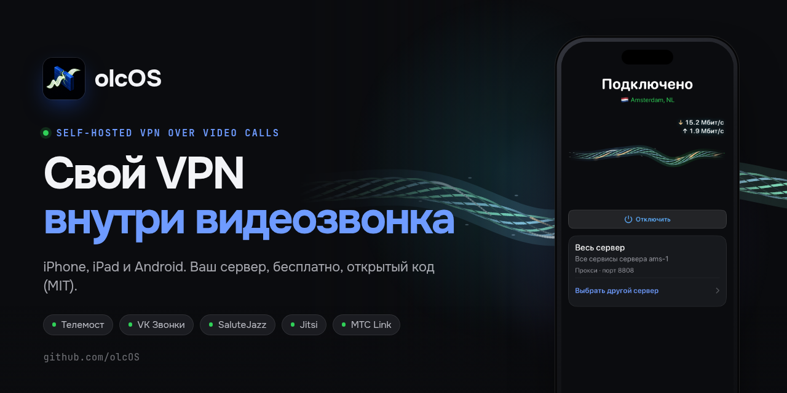

  

olcOS — VPN для iPhone, iPad и Android, который работает через ваш собственный сервер. Трафик идёт внутри обычного
видеозвонка в Телемосте, VK Звонках, SaluteJazz, Jitsi или МТС Link. Приложения бесплатные, код открыт.

| [iPhone и iPad](https://github.com/olcOS/olcos-ios) | [Android](https://github.com/olcOS/olcos-android) | [Сервер](https://github.com/olcOS/olcos) |
|---|---|---|
| SwiftUI, iOS 17+. VPN или SOCKS5-прокси, виджеты и Live Activity. Здесь же общее ядро на Go. | Kotlin и Jetpack Compose, Android 8+. VPN или SOCKS5-прокси, управление сервером с телефона. | Установка одной командой или из приложения по SSH. Релизы для обеих платформ. |

[Скачать последнюю версию](https://github.com/olcOS/olcos/releases/latest) · [Сайт](https://olcos.github.io) · [Сообщить об ошибке](https://github.com/olcOS/olcos/issues)

A self-hosted VPN for iPhone, iPad and Android that carries your traffic to your own server inside ordinary video
calls. Free and open source. [Website in English](https://olcos.github.io/en/).
